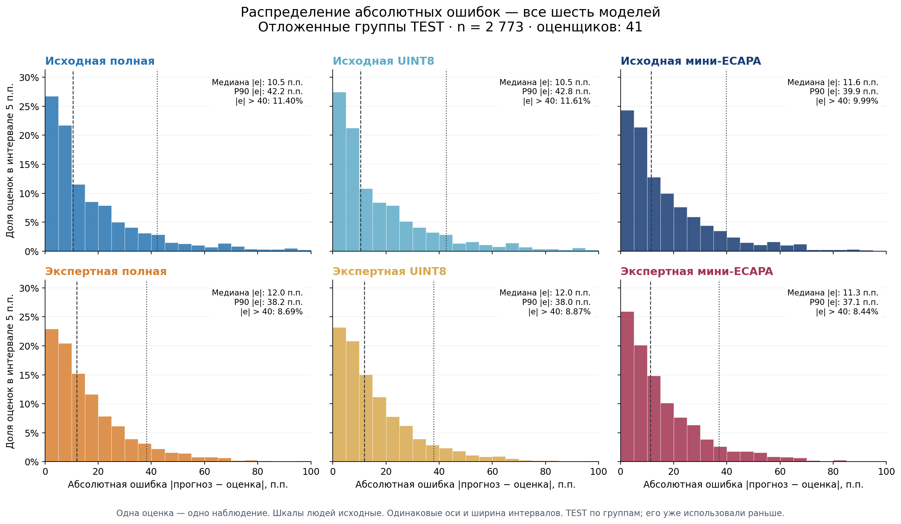
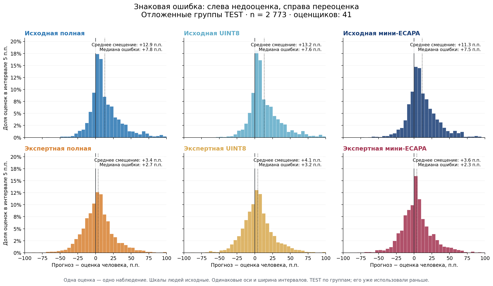
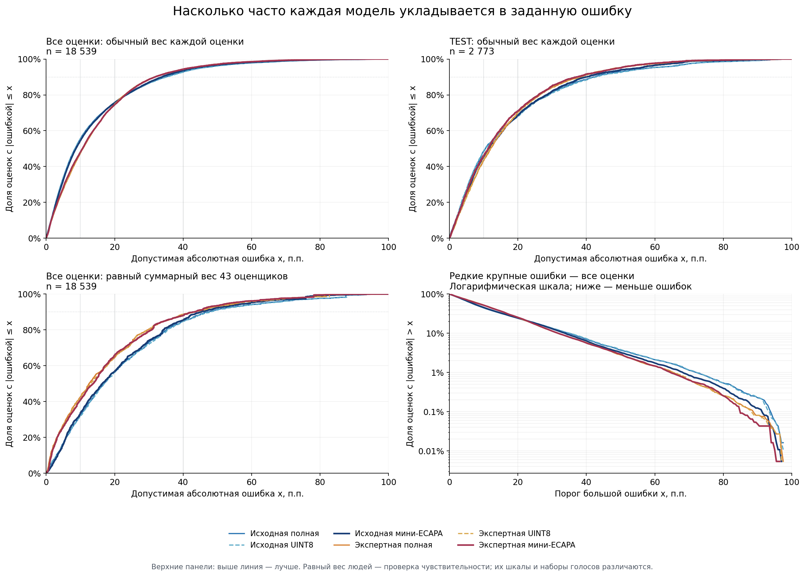

# All-human error distributions / Ошибки по всем человеческим оценкам

18,539 genuine judgments, 43 raters; one supplied 48% of judgments. All-data
plots include TRAIN. The reused TEST contains 2,773 human judgments. Rater
scales were not transformed. Propagated labels are not new listening votes.

18 539 оценок 43 людей; один оценщик дал 48%. Все данные включают TRAIN,
прежний TEST содержит 2 773 оценки. Шкалы людей не выравнивались. Равный вес
оценщиков меняет и состав голосов, поэтому это проверка чувствительности.

- All judgments / Все оценки:
  [absolute errors](absolute_errors_all.png), [signed errors](signed_errors_all.png).
- [Summary JSON](summary.json), [CSV](summary.csv).
- [Interactive report source](report.html): download/open locally; no audio or
  per-record identifiers included. PNGs also have adjacent SVG vector versions.
- [Expert-only distributions](../expert-only/README.md),
  [methods and limitations](../../../../EXPERIMENTS_2026-10-30.md).
