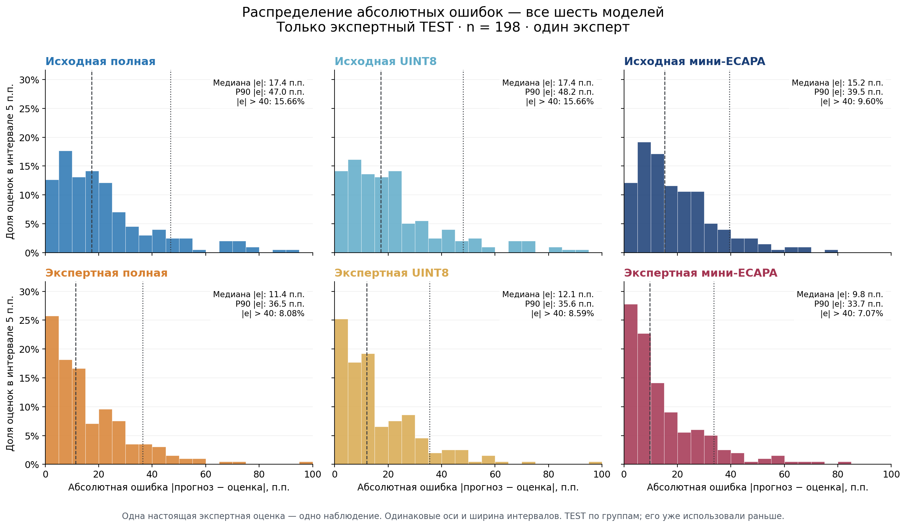
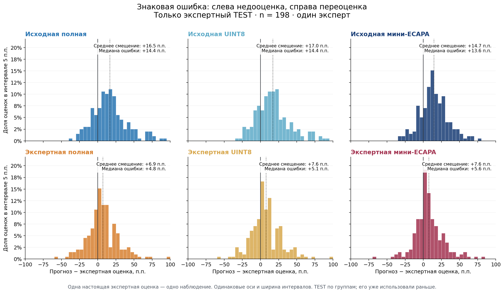
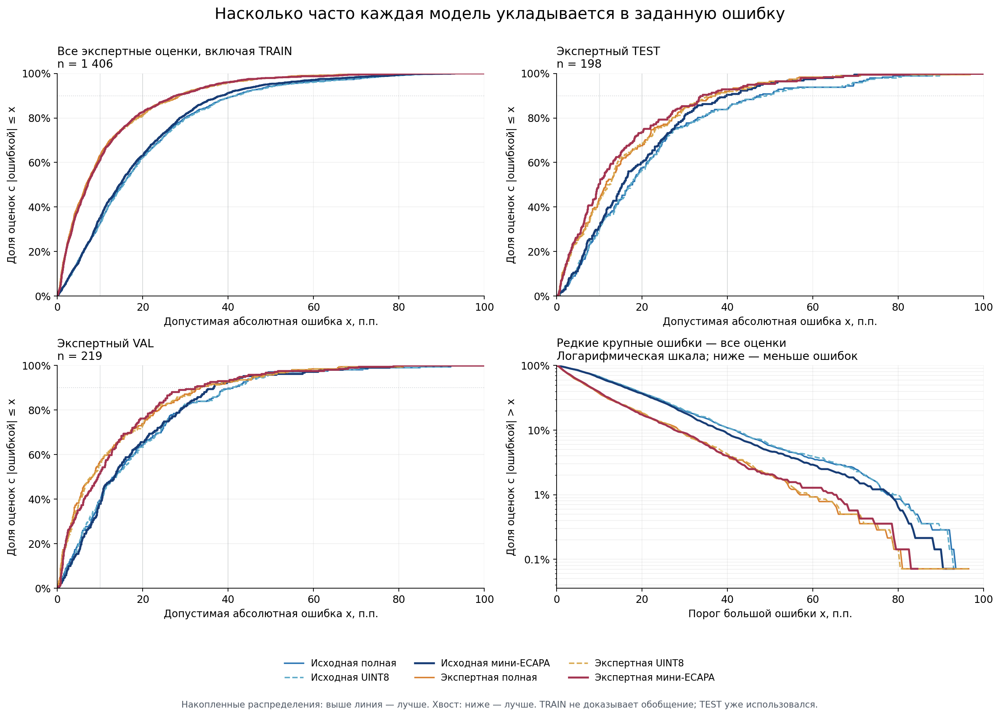

# Expert-only error distributions / Ошибки по экспертным оценкам

1,406 genuine judgments from one vocal expert: 206 individual and 1,200 listened
cluster representatives. TRAIN 989 / VAL 219 / TEST 198. Propagated labels are
not counted as extra judgments. TEST was inspected in earlier experiments.

1 406 настоящих прослушиваний одного эксперта, без дополнительных перенесённых
меток. «Все данные» включают TRAIN; TEST уже использовался ранее.
Положительная знаковая ошибка означает завышение моделью оценки человека.

- All expert judgments / Все экспертные оценки:
  [absolute errors](absolute_errors_all.png), [signed errors](signed_errors_all.png).
- Vector versions / Векторные версии:
  [absolute TEST](absolute_errors_test.svg), [signed TEST](signed_errors_test.svg),
  [absolute all](absolute_errors_all.svg), [signed all](signed_errors_all.svg),
  [CDF](error_cdf_comparison.svg).
- [Summary JSON](summary.json), [CSV](summary.csv), [Russian summary](REPORT_RU.md).
- [Interactive report source](report.html): download and open locally; GitHub
  does not execute HTML previews. No audio or per-record identifiers included.
- [All-human distributions](../all-human/README.md),
  [methods and limitations](../../../../EXPERIMENTS_2026-10-30.md).
