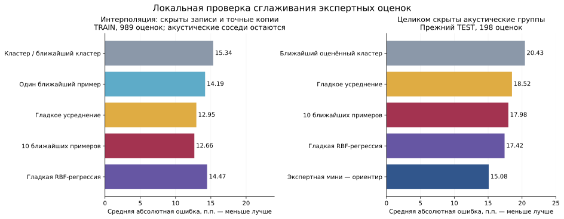
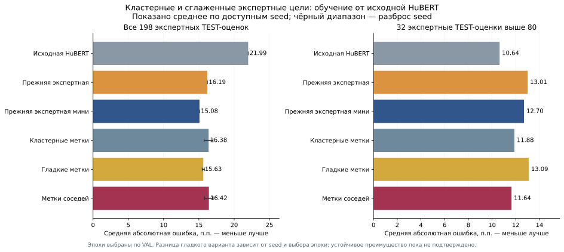

# Smooth expert targets / Гладкие экспертные цели

[Bilingual experiment report / Двуязычный отчёт](../../../EXPERIMENTS_2026-10-31.md)

## Local interpolation check / Локальная интерполяция

Left: held recordings and exact copies, with acoustic neighbors allowed to
remain. Right: reused TEST with entire acoustic groups held out. These test
different forms of generalization. Existing recording vectors were used;
exact five-second features were subsequently recomputed for the GPU experiment.

Слева скрывались записи и их точные копии, похожие записи могли оставаться.
Справа целиком скрыты акустические группы. Это разные проверки переноса.

## GPU comparison / Сравнение GPU-обучений

New full-model variants average two seeds, initialized from the same original
HuBERT. Black ranges indicate seed spread, not confidence intervals. There is
no demonstrated robust win; the previous expert mini remains the retained
practical model. Checkpoint selection used VAL only; TEST was previously reused.

Новые полные варианты усреднены по двум seed со стартом от исходной HuBERT.
Чёрный диапазон — разброс seed. Улучшение гладкого варианта неустойчиво и
связано также с выбором разных эпох; предыдущая экспертная мини сохранена.

[Aggregate JSON](../../../experiments/smoothing-2026-10-31.json) ·
[CSV metrics](../../../experiments/smoothing-2026-10-31.csv)

No audio, individual predictions, original file names or rater IDs included.
Аудио, индивидуальные прогнозы, имена записей и ID оценщиков исключены.
